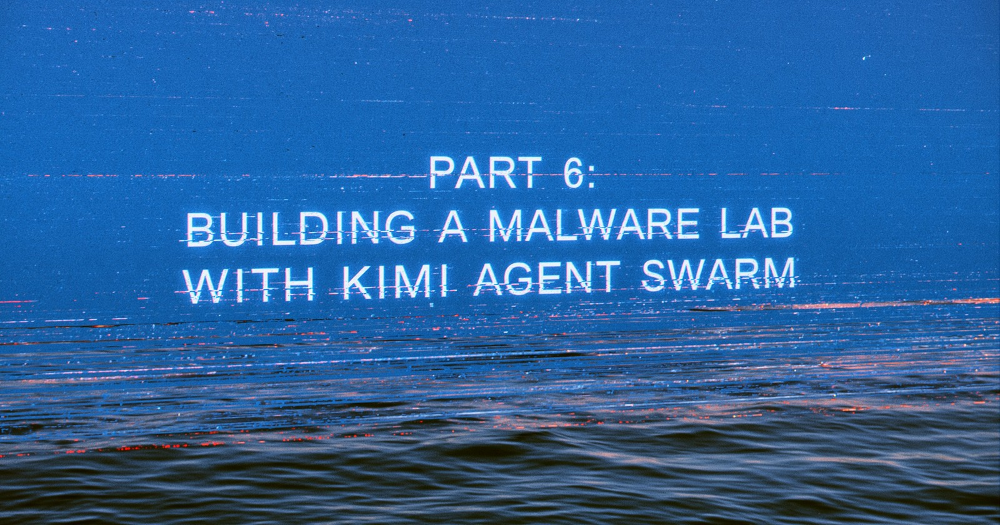
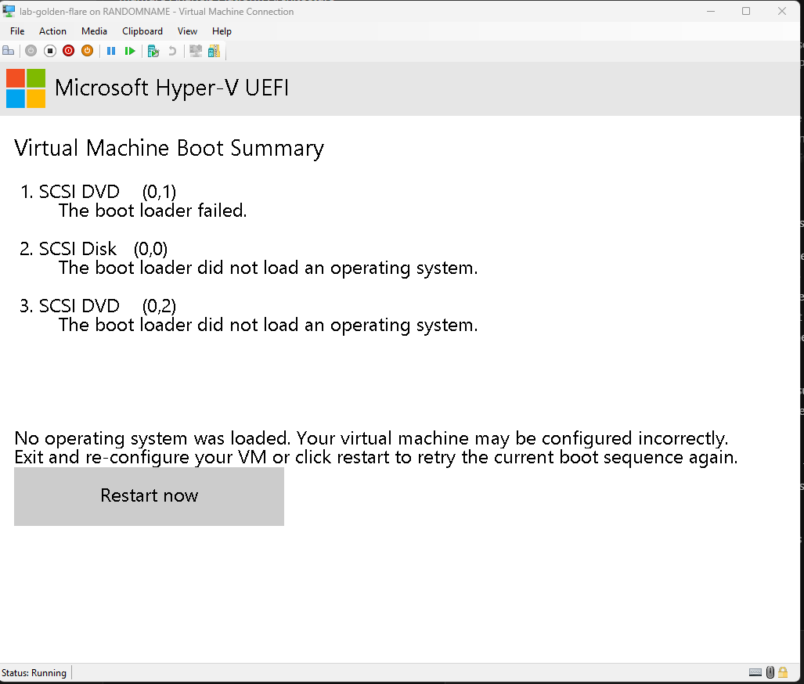
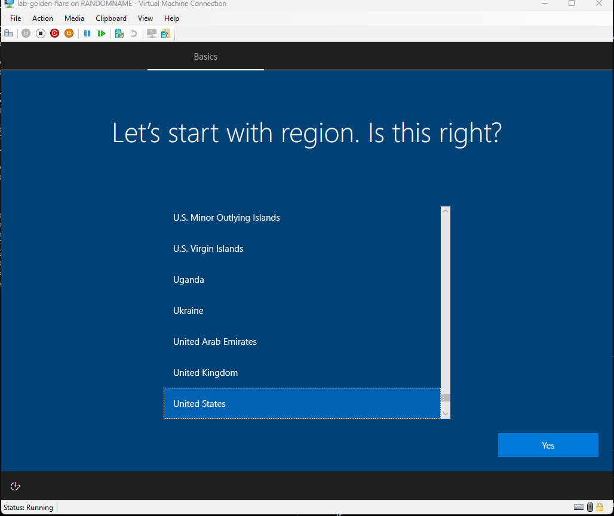
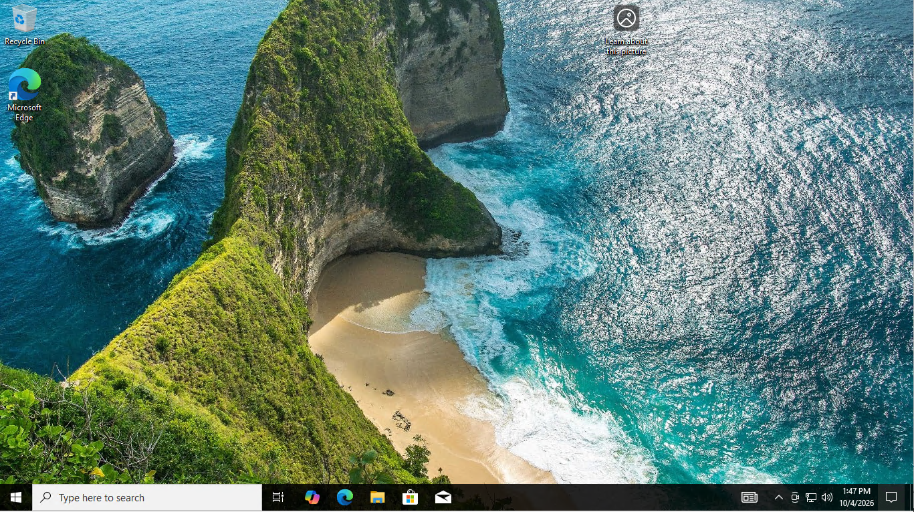
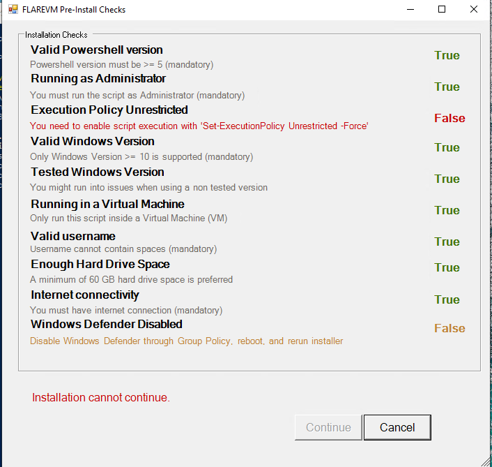
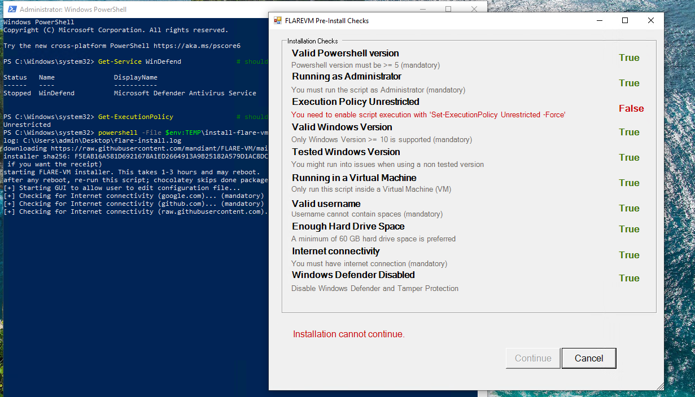
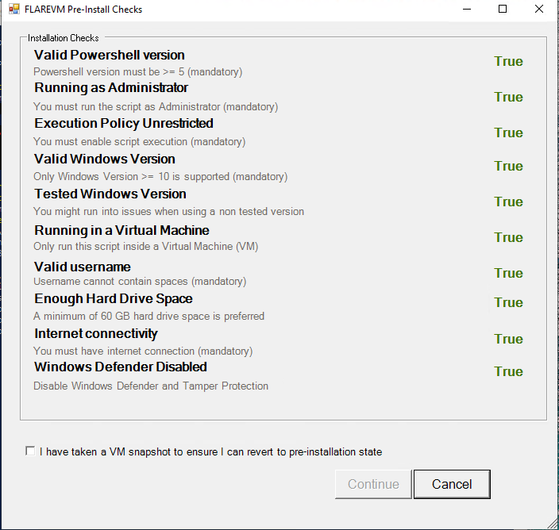

I've been pretty busy, but this has been sitting in the back of my mind. Happy Halloween Everyone! 

Part 5 ended with a real sample going through the static pipeline and a report whose capa, FLOSS, and YARA findings each cite the claims log. It also ended with the diagram still half empty. The FLARE-VM box, the detonation VM, the whole dynamic side of the lab, existed as a dashed border and nothing else.

This post builds the Windows side. Nothing detonates in it. The gate from Part 2 stays closed by construction the entire time. Part 5 said the next post would run a sample in an isolated VM. That slipped, and the room is why. Before this lab runs live malware with real execution, the room it runs in has to exist, and the room turned out to be the hardest build of the series so far.

If you would like to catch up, the links to Posts 1-5 are in the sidebar.

## Survey before planning

The first move was not building anything. The Part 1-era lab left Hyper-V state behind, and the honest question was whether any of it was reusable. I inventoried instead of assuming: VMs, virtual disks, switches, ISOs, RAM.

The old golden image and slot VMs were gone. Cleaned up at some point during the host machine trouble a while back, and nobody wrote down what was lost. Reuse was dead before it started, which cost five minutes to learn instead of a weekend.

The survey also surfaced what survived, and that list drove every decision after it: a Windows 10 22H2 business ISO on disk, 32 GB of RAM, an i7-12700K, and an orphaned Private virtual switch left over from the first build. 22H2 left support in October 2025. For a detonation target that is a feature. Plenty of real malware still aims at Windows 10, and a machine that reverts to a checkpoint has no use for patches anyway. That switch has no host virtual NIC, which makes it a candidate for the sandbox network later. For now it sits unused, which is where it belongs until the design says otherwise.

## The two decisions that shaped everything

**Unattended install.** A golden image that cannot be rebuilt from a file is a golden image that drifts, and drift is how two machines with the same name stop being the same machine. Reproducibility here is a security property, not a convenience.

**Full FLARE-VM installer, with a snapshot taken immediately before it runs.** The installer is the known bear trap of this build. Dozens of packages, version pinning, at least one reboot, a multi-hour runtime. Rollback is the mitigation, so the snapshot comes first and the installer runs second.

What I noticed afterward is that "most secure" and "most tools" never conflicted. They were the same decision wearing two hats. When the security answer and the coverage answer converge, decide fast and spend the saved time on the decisions that are actually contested.

## What broke, in the order it hurt

This build produced four failures worth writing down, and the fourth one is a three-round saga on its own.

### 1. The ISO builder, eaten by COM twice

The unattended install needs a second disc carrying the answer file. Windows can build ISOs through IMAPI2, so the script did that, and it died at the last step: copying the image stream to disk failed with `does not contain a method named 'Read'`.

The method exists. The binding cannot see it. `IStream` is a pure vtable interface with no `IDispatch` ancestry, so PowerShell's late-bound calls find nothing, and a language cast to `ComTypes.IStream` fails too because PowerShell casts do not perform COM QueryInterface. The fix was a twenty-line C# helper compiled into the session with `Add-Type`, where `(IStream)imageStream` is a real QueryInterface and the call works the way the documentation assumes.

Two smaller lessons inside this one. The risky step ran before the expensive step and failed into a status file, so reruns were free. And the fix was testable without elevation, because building an ISO touches no privileged APIs, so it was verified end to end with 7-Zip before an elevated run was spent on it.

### 2. The boot loader failure, built on an unchecked assumption

The VM booted the Windows ISO and failed immediately: "the boot loader failed." The working hypothesis was Secure Boot rejecting the disc. The test script I wrote to turn Secure Boot off and retry printed its first line and killed the hypothesis: `secure boot was: Off`. I had assumed a Gen 2 default without checking the actual machine, which is exactly the mistake Part 1 warned about with defaults.

With Secure Boot already off and the boot still failing, the disc layout itself was the problem. The fallback became the main path: skip DVD boot entirely, apply the Windows image to the virtual disk offline with DISM, write the bootloader with bcdboot, attach the answer file into the image, boot the VHD directly.

### 3. The silent unattend

The offline apply worked. The VM booted, and landed on a region selection screen. That screen was the only detector that the unattended settings had never reached the image. Everything else said success: exit code 0, a log line claiming the answer file was applied.

The cause took reading the tool's actual contract. [Microsoft's documentation for the option](https://learn.microsoft.com/en-us/windows-hardware/manufacture/desktop/dism-unattended-servicing-command-line-options) says DISM applies the settings in the `offlineServicing` pass and does not cache the answer file on the target. The passes that skip OOBE and create the local account are processed at first boot, and Setup picks the answer file up from `C:\Windows\Panther\unattend.xml`. Mine wasn't there, so none of it ran. The script applied a configuration the tool was never going to finish applying, reported success, and the only witness was a screen I had to click through by hand. Recovery this time was two minutes of OOBE. The fix for the next rebuild is one copy command in the offline phase. That fix is untested, and it stays that way until the rebuild listed under "Still unbuilt" happens.

### 4. The pre-check saga

FLARE-VM ships a Pre-Install Checks window that refuses to continue until the environment is right. Ten checks. This is the same instinct as the lab's detonation gate, which made losing three rounds to it personally embarrassing and professionally useful.

**Round one.** Seven green, two red. Execution Policy and Windows Defender. I set the persisted execution policy to Unrestricted and disabled Defender's realtime monitoring, both clean, rebooted, reran. Identical window. Identical reds.

Guessing was done. The installer's own code got read instead, and it said three things the error messages had not. First, the execution policy check compares `Get-ExecutionPolicy` to the string `Unrestricted`, and that returns the session policy. Every launch was handing the check a session it had contaminated itself. Second, the Defender check queries the state of the `WinDefend` service. Realtime monitoring being off does not stop the service, so that setting could never pass. The supported mechanism is a Group Policy key that stops the service at next boot. Third, Tamper Protection is checked on its own and reverts Defender configuration changes, so it has to go first, through the Windows Security UI, by hand.

**Round two.** Tamper Protection off, policy key set, reboot, and a hand verification that should have ended it: service Stopped, policy Unrestricted, both confirmed in the same terminal. Nine of ten checks green. Execution Policy still red.

The saboteur was one line inside my own wrapper script, which launched the official installer as a child process with `-ExecutionPolicy Bypass` re-applied. Every session I checked was clean. The session the check actually ran in was Bypass, because my automation handed it that flag on every run, no matter how the wrapper itself was invoked. The fix was deleting the flag from my own code. There was one more tripwire after that: the wrapper copy inside the guest had been copied off the DVD, and files off optical media carry the read-only attribute, so editing it failed with "Access to the path is denied" until the attribute was cleared.

**Round three.** Ten for ten, including the installer's own checkbox asking me to confirm a snapshot exists. It exists. It was taken before the installer ever ran, which is the only reason three rounds of failure cost an hour instead of a rebuild.

The installer then ran for the better part of an afternoon. One reboot, zero failed packages, and the build moved to its last phase: proving the result and sealing it.

The pre-check saga, all three rounds of it, came down to one habit: acting on what a tool's message suggests instead of what its code checks. The error text said "run Set-ExecutionPolicy," which was necessary and nowhere near sufficient. The check defined the test. The code had the answers the whole time, which is a sentence that could close every post in this series.

## What network was the golden on?

The screenshots show the installer downloading from the official repo, so the golden had internet during the install. It did. The golden lived on the Default Switch, Hyper-V's NAT network, for the entire build. FLARE-VM pulls dozens of packages from GitHub. I never tried an offline path.

The Default Switch also gives the host a virtual adapter, which means the golden had a route toward the host during the build. No malware ran in that window, and this VM never saw a sample. The series rule is no route to host, so the exception gets stated here.

The orphaned Private switch, the one with no host NIC and no route out, sat unused through all of it. It is reserved for detonation traffic later.

The cutoff is part of the artifact now, not a procedure. The first pass at this post flagged the NIC still wired to the Default Switch inside the seal, so the NIC came off and `Golden-Sealed` was re-taken with the machine in that state. The checkpoint itself carries no wire. Slot creation is designed to refuse while the golden is on, and each slot is a full copy that gets its own NIC on the Private switch at creation, before its first boot. The golden still never boots again. The seal just does not lean on that rule anymore.

## Where it stands

Solid: the golden VM with FLARE-VM installed and verified, the tooling path into it, and two checkpoints. `Pre-FLARE`, taken before the installer ever ran, is the rollback insurance. `Golden-Sealed`, taken after, is the artifact everything downstream builds on.

The install finished clean. Twenty-two tool categories on the desktop, a debugger and a PE viewer both launch, zero failed packages. One receipt note: the wrapper's log has no exit code, because FLARE-VM's installer reboots the machine itself and kills the wrapper before it can write one. The proof the install finished is subtler. FLARE-VM customizes the PowerShell prompt, and the prompt now carries the install date. Our logging assumed the wrapper would outlive the installer. An installer that reboots disagrees.

Sealing took three moves, then a fourth. Windows Update's service is stopped and disabled, so the golden stops drifting. Disabling its scheduled task got an access denied; that task is owned by SYSTEM, and its only job is starting the service we already disabled, so the control holds and the refusal is documented instead of fought. Then the VM went off, the tools disc was ejected, and the `Golden-Sealed` checkpoint was taken. The fourth came later, after this post's own draft showed the NIC still attached inside the seal. The NIC came off and the checkpoint was re-taken. The network cutoff lives in the artifact, the same standard as every other control in this series.

Still unbuilt, stated plainly: the slot pool. The plan is N slot VMs, each a full copy of the sealed golden, reset by revert, and the acceptance test is simple: run a marker in a slot, revert, prove the marker is gone. If reset cannot be proven, the pool does not exist. Next to it, a rebuild from file, proven end to end. The answer file has a known fix waiting and one full rebuild has not been run. Until it has, reproducibility is designed, not demonstrated. The one-way doors for Windows (sample in push-only, artifacts out through pre-signed URLs) are designed and waiting on the pool. The sandbox network with INetSim answering for every domain gets its own post. Detonation stays gated until the approval path from Part 2 exists, and that default is closed.

## What's next

The slot pool. Build the slot VMs, run the marker, revert, prove the marker is gone. A malware lab whose VMs cannot be provably reset is a malware lab that lies about its most important property, and this series has had enough of things that lie.

Then the gate opens. Carefully.

